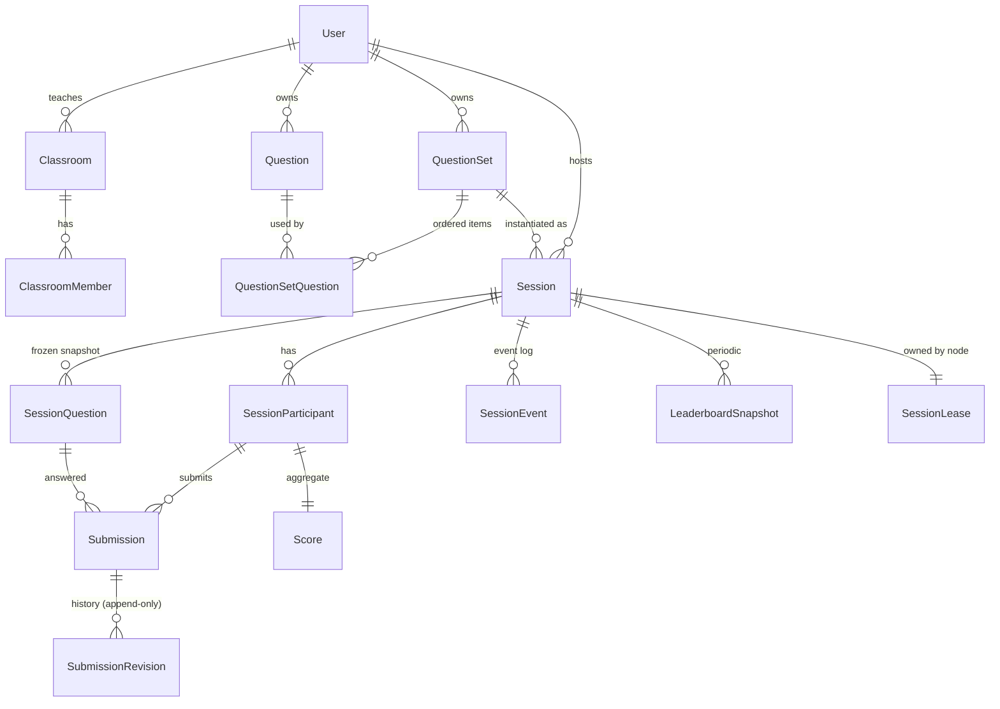

# BrainBattle 설계 문서 (v0.1)

> 이 문서는 요구사항 §40의 순서(요구사항 분석 → … → 테스트)를 따르며, **실제 구현과 1:1로 대응**합니다.
> 각 절 끝의 `→` 표시는 해당 설계를 구현한 소스 위치입니다.

---

## 1. 요구사항 분석

### 1.1 제품의 본질

| 모드 | 흐름 | 서버의 역할 |
|---|---|---|
| Digital Question | 문제 → 답안 → 채점 → 점수 | 문제 전달(정답 제외), 채점, 순위 |
| Paper Battle | 종이 문제지 + 디지털 답안 + 실시간 채점 + 점수판 | 디지털 답안지, 채점, 점수판 |
| Exam | 시험 진행 + 답안 관리 + 채점 + 결과 분석 | 시간 통제, 답안 보관·수정 이력, 결과 공개 통제 |

세 모드는 별개 제품이 아니라 **4개의 직교 축의 조합**입니다. 프리셋은 이 축의 기본값일 뿐입니다.

| 축 | 값 |
|---|---|
| 제공 방식 `deliveryMode` | `DIGITAL` / `PAPER` (문항 단위로도 지정 가능, 세션이 PAPER면 전체 PAPER) |
| 진행 방식 `progressMode` | `SYNCHRONIZED` / `FREE` |
| 점수 정책 `scoringMode` | `POINT_BASED` / `CORRECT_COUNT` / `ACCURACY_SPEED` / `CUSTOM` |
| 공개 정책 | `revealPolicy`(정답·정오) × `scoreboard.visibility`(순위) × `editPolicy`(수정) |

### 1.2 Server-authoritative 원칙의 구체화

클라이언트는 **입력과 표시만** 합니다. 다음 값은 서버만 계산하고 클라이언트 값은 무시합니다.

- 세션/문항 상태, 시작·마감 시각(절대 시각, 서버 시계), 제출 가능 여부
- 참가자 identity(연결 객체에서 도출, payload의 participantId 무시), 제출 revision
- 채점 결과(정규화 포함), 점수, 순위, 응답 시간(`effectiveSubmittedAt − questionStartedAt`)
- 클라이언트 timestamp는 §7의 조건을 모두 통과할 때만 제한적으로 채택

### 1.3 요구사항 간 충돌과 해결 (임의 삭제 없이 의도 유지)

| # | 충돌 | 원인 | 선택한 구현 |
|---|---|---|---|
| C1 | **1초 신뢰 규칙** vs **오프라인 재전송 시 클라이언트 제출 시각 인정**(§14) | 재연결 후 재전송은 필연적으로 1초 이상 늦게 도착 → 1초 규칙만 적용하면 정상적인 오프라인 제출이 전부 서버 시각으로 떨어짐 | 1초 규칙은 **라이브 제출**에 그대로 적용. `replay:true` 재전송만 별도 검증 경로 `OFFLINE_REPLAY_VERIFIED`(누른 시각 ≤ 서버가 관측한 disconnect + 1s, 오프라인 창 ≤ 120s(설정), 재연결 후 30s 이내 전송, 같은 clock epoch의 검증된 sync)로 인정. 그 외는 `SERVER_FALLBACK` |
| C2 | **서버 deadline 우선**(§30) vs **1초 이내 차이는 클라이언트 시각 신뢰** | 마감 200ms 전에 누른 답이 네트워크 지연으로 마감 300ms 후 도착 | 판정 기준은 **effectiveSubmittedAt**(신뢰된 경우 클라이언트 시각). 단 마감 후 도착은 `CLIENT_TRUSTED`이고 `lateGraceMs`(기본 1000ms) 이내일 때만. 신뢰되지 않은 늦은 제출은 `SUBMISSION_CLOSED/SESSION_LOCKED`. 서버가 마감 시점에 `QUESTION_END/SESSION_LOCKED`를 먼저 방송하므로 UI는 즉시 잠김 |
| C3 | **답안 수정 허용** vs **실시간 점수/순위 공개** | 제출 직후 점수·순위가 변하면 정오가 드러나고, 수정 허용이면 정답을 찾아 고칠 수 있음 | ① **Score hold**: 정답 공개 정책이 `IMMEDIATE`가 아니면 열린 문항의 점수 변화는 교사에게만 즉시 전송, 학생·점수판에는 문항 마감(동시 진행)/세션 종료(자유 진행) 시 공개. ② `IMMEDIATE` + 수정 허용 조합은 허용하되 서버가 경고(`EDIT_WITH_LIVE_FEEDBACK`) 반환. ③ Paper Battle 프리셋 기본값을 "제출 후 수정 불가"로 |
| C4 | 요구 단축키 **Ctrl+2** 등 vs 브라우저 예약 키 | Chrome/Edge/Firefox는 Ctrl+1..9(탭 전환), Ctrl+Shift+I/J/C(DevTools), Ctrl+W/T/N을 페이지에 넘기지 않음 | 기본 프로필은 요구대로 유지. **웹**에서만 예약 키를 `Alt+키`(Linux는 `Ctrl+Alt+키`)로 자동 리매핑, **데스크톱 앱**은 원래 키 사용(Electron 메뉴에 Ctrl+R/P/숫자 가속키를 두지 않음). 사용자별 재지정 UI(`/settings`) 제공. Ctrl+R(새로고침)·Ctrl+P(인쇄)는 에디터 포커스 중 가로채기 가능하므로 그대로 사용 |
| C5 | 슬래시 명령 `/frac` vs 수식 입력에서 `/`는 분수 | `/`를 누르는 순간 분수로 바뀌면 `/frac`를 입력할 수 없음 | `/` 입력 시 **명령 팔레트** 진입. 영문자는 팔레트 필터, Enter/Tab/Space로 선택. 숫자·괄호 등 다른 문자가 오면 즉시 `/`를 일반 분수로 입력하고 그 문자를 이어서 처리(`1/2` 정상 동작) |
| C6 | 공개 정책 8종의 의미가 겹침(개인 점수만/점수만 표시/순위 숨김) | 요구사항에 정의 없음 | §8.4 표로 명확히 정의(점수판·학생 각각에 대해 무엇이 보이는지) |
| C7 | 수정 정책 4종("수정 허용"과 "세션 종료 전까지"가 동일해 보임) | 진행 방식에 따라 의미가 다름 | `ALLOW`: 해당 문항이 제출 가능한 동안. `NO_EDIT`. `UNTIL_QUESTION_END`: 동시 진행=ALLOW, **자유 진행=학생이 다른 문항으로 이동하면 확정**. `UNTIL_SESSION_END`: 세션 잠금 전까지(자유 진행에서 ALLOW와 동일, 교사 수동 채점 후에도 수정 가능) |
| C8 | 속도 점수 × 자유 진행 | 자유 진행엔 "문항 시작 시각"이 학생별로 다름 | `questionStartedAt` = 세션 시작 시각으로 정의(클라이언트 값 불신 원칙 유지), 설정 시 경고 `SPEED_IN_FREE_MODE` |
| C9 | Paper 모드 객관식 | 종이 문제지에만 선택지 내용이 있음 | 선택지 **번호(①~⑤)만** 전송, 내용·제목·첨부는 서버가 제거 |
| C10 | "Participant 즉시 삭제 금지" vs 강퇴 | — | 참가자는 삭제하지 않고 상태 `KICKED`, 재접속 거부, 제출 기록은 보존, 순위에서만 제외 |

---

## 2. Domain Model



핵심 결정

- **Question vs SessionQuestion**: 세션 생성 시 문항을 `snapshot`(JSONB)으로 **동결**합니다. 진행 중에 문제 은행을 수정·삭제해도 진행 중/종료된 세션과 채점 결과가 바뀌지 않습니다.
- **questionId ≠ displayNumber**: 내부 ID는 `q_…`/`sq_…` 불투명 문자열, 표시 번호는 자유 문자열(`7`, `15-1`, `A`, `서술형 1`). 우선순위: 세트 항목 override → 문항 기본값 → 순번.
- **participantId ≠ connectionId**: 참가자는 DB 레코드(`p_…`), 연결은 소켓마다 새로 생성되는 `conn_…`. 재접속은 `resumeToken`(SHA-256 해시만 저장) 또는 학생 계정으로 participantId를 복구합니다.
- **Submission(현재 답) + SubmissionRevision(이력)**: `(participant, sessionQuestion)`당 현재 답은 1행, 모든 제출·수정은 revision으로 append-only 보관(삭제하지 않음).
- **Score**: 제출로부터 언제든 재계산 가능한 집계(materialized). 제출과 같은 트랜잭션에서 갱신.
- 추가 엔티티: `Classroom/ClassroomMember`(학급 제한), `SessionLease`(세션 소유권), `AuditLog`(REST 중요 행위).

→ `packages/shared/src/{question,session}.ts`, `apps/server/src/realtime/types.ts`

---

## 3. 시스템 아키텍처

```
 Student (Web, 설치 없음)      Teacher (Web / Electron)        Scoreboard / Projector
        │  REST(HTTPS) + WebSocket(WSS)  │                              │ (read-only token)
        └───────────────┬────────────────┴──────────────┬───────────────┘
                        ▼                                ▼
              ┌──────────────── Load balancer (optional) ─────────────────┐
              │  WS: hash($arg_sid) → 세션 소유 노드 / REST: round-robin   │
              └───────────────┬───────────────────────────┬───────────────┘
                              ▼                           ▼
                ┌──── Battle Server node A ───┐   ┌── node B ──┐   (동일 코드, stateless REST)
                │ Fastify REST  │ WS Hub       │   │    …       │
                │ SessionManager (leases)      │   └────────────┘
                │  └ SessionRuntime (actor/세션)│
                │     state machine · timers   │
                │     grading · ranking        │
                └──────────────┬───────────────┘
                               ▼
                        PostgreSQL (authoritative, 모든 상태 영속)
```

### 3.1 세션 단위 Actor
- 세션마다 `SessionRuntime` 1개가 **모든 명령을 직렬 큐**로 처리합니다(같은 세션 내 race condition 제거).
- 명령 처리 순서: 권한 확인 → 상태 전이 검증 → **DB 트랜잭션 커밋** → 메모리 반영 → 이벤트 방송. 즉 **ACK/ANSWER_ACCEPTED는 커밋 이후에만** 전송됩니다.
- 실시간 조회(순위·통계·제출 현황)는 액터 메모리에서 제공하여 **이벤트마다 DB 조회를 하지 않습니다**. DB는 쓰기 + 재수화(hydration) 용도입니다.
- `serverReceivedAt`은 소켓 계층에서 프레임 수신 즉시 찍습니다(큐 대기 시간이 학생에게 불리하지 않도록).

### 3.2 Session ownership / 수평 확장 / 장애 복구
- 라이브 세션은 정확히 하나의 노드가 소유합니다: `session_leases(session_id, node_id, node_url, expires_at_ms)`. 획득은 조건부 UPSERT(만료됐거나 내 것일 때만), `ttl/3`마다 갱신, 갱신 실패 시 런타임 즉시 언로드(split-brain 방지).
- 다른 노드로 들어온 JOIN은 `SESSION_OWNED_ELSEWHERE {ownerUrl}`로 리다이렉트, 클라이언트가 자동 재연결합니다. LB는 `?sid=`로 해시하여 이를 최소화합니다.
- 세션 행에는 `version` 컬럼으로 **낙관적 동시성 제어**(`UPDATE … WHERE version=$n`)를 추가해 lease가 깨지는 극단 상황에서도 이중 쓰기를 막습니다.
- **장애 복구**: 노드가 죽으면 lease가 만료되고, 다른 노드의 복구 루프(`recoverOrphans`, 기동 시 + 주기적)가 ACTIVE/PAUSED 세션을 인수합니다. 마감 시각은 모두 **절대 시각으로 저장**되어 있으므로 타이머를 그대로 재구성하고, 이미 지난 마감은 **원래 마감 시각으로** 잠급니다. 참가자 clock sync 상태(epoch별 offset)도 영속화되어 재전송 검증이 계속 가능합니다. (자동화 테스트 `recovery.test.ts`)
- Redis는 필수가 아닙니다: 세션의 모든 연결이 소유 노드에 모이므로 노드 간 pub/sub가 필요 없습니다. 초대형 규모에서 lease 저장소를 Redis로 바꾸는 것은 `SessionManager`의 lease 메서드 3개 교체로 가능합니다.

→ `apps/server/src/realtime/{sessionRuntime,sessionManager,hub}.ts`

---

## 4. Database Schema

PostgreSQL 방언. 개발/테스트는 동일 SQL을 **PGlite**(WASM Postgres, 설치 불필요)로 실행합니다. 마이그레이션은 버전 관리(`schema_migrations`).

| 테이블 | 주요 컬럼 | 비고 |
|---|---|---|
| users | id, email(unique lower), password_hash(bcrypt), role | |
| classrooms / classroom_members | teacher_id / (classroom_id,user_id) PK | 학급 제한 참가 |
| questions | display_number, type, title, description(jsonb), choices, correct_answer, accepted_answers, grading(jsonb), score, time_limit_sec, explanation, attachments, delivery_mode, deleted_at | soft delete |
| question_sets / question_set_questions | position `UNIQUE(set_id, position) DEFERRABLE` | 트랜잭션 안에서 순서 재배치 |
| sessions | state(CHECK), settings(jsonb), join_code, current_sq_id, started/deadline/locked/finished_at_ms, pauses(jsonb), results_released, event_seq, **version** | |
| session_questions | snapshot(jsonb), phase(CHECK), opens/started/deadline/locked_at_ms | 동결 사본 |
| session_participants | status, resume_token_hash(unique), clock_sync(jsonb), progress(jsonb) | |
| submissions | answer(jsonb), normalized, revision, client_sent/server_received/effective_submitted_at_ms, timestamp_source/reason, response_ms, is_correct, auto/manual/final_score, grading_status | `UNIQUE(participant_id, session_question_id)` |
| submission_revisions | + idempotency_key, client_mono_at, clock_epoch_id, is_replay | `UNIQUE(participant_id, idempotency_key)`, `UNIQUE(submission_id, revision)` |
| scores | total_score, correct_count, answered_count, last_scored/correct_at_ms, total_response_ms | PK(session_id, participant_id) |
| leaderboard_snapshots | version, reason, entries(jsonb) | 30s 주기 + 문항/세션 종료 |
| session_events | seq, type, actor_type/id, payload | `UNIQUE(session_id, seq)` — 감사/리플레이 |
| audit_logs | actor, action, target, ip | REST 중요 행위, 로그인 실패, 잘못된 참가 코드 |
| session_leases | node_id, node_url, expires_at_ms | 소유권 |

시각 컬럼: 프로토콜 판정용은 `bigint` epoch ms(서버 시계), 감사용은 `timestamptz`.

### 4.1 인덱스 전략 (요구 조회 → 인덱스)

| 요구 조회 | 인덱스 |
|---|---|
| 특정 세션 참가자 전체 | `sp_session_idx (session_id, joined_at_ms)` |
| 특정 세션 현재 순위 | 실시간: 액터 메모리 정렬 구조. DB: `scores_ranking_idx (session_id, total_score DESC, correct_count DESC, last_scored_at_ms)` |
| 특정 학생 제출 답안 | `submissions_session_p_idx (session_id, participant_id)` |
| 특정 문제 제출 현황 | `submissions_session_q_idx (session_id, session_question_id)` |
| 세션별 실시간 통계 | 액터 메모리 집계(이벤트당 O(참가자)), 결과 분석은 위 두 인덱스로 `GROUP BY` |
| 참가 코드 조회 | `sessions_join_code_live_uq (join_code) WHERE state <> 'FINISHED'` (부분 유니크: 종료 세션은 코드 반환) |
| 중복 제출 방지 | `submission_revisions (participant_id, idempotency_key)` UNIQUE |
| 재접속 | `sp_resume_token_uq (resume_token_hash)` |
| 교사 목록 | `questions_owner_idx`, `question_sets_owner_idx` (부분 인덱스 `deleted_at IS NULL`), `sessions_teacher_idx` |

→ `apps/server/src/db/schema.ts`

---

## 5. Session State Machine

```
                 open            ready
   CREATED ──────────▶ LOBBY ◀────────▶ READY
      │                  │  start          │ start
      │                  └──────▶ ACTIVE ◀─┘
      │                          │   ▲
      │                    pause │   │ resume
      │                          ▼   │
      │                         PAUSED
      └──────── end ──────────────┴──────▶ FINISHED (terminal)
```

- 전이 테이블(`SESSION_TRANSITIONS`)은 공유 패키지에 있고, **서버가 모든 명령에서 검증**합니다. 클라이언트는 버튼 활성화에만 사용합니다.
- 같은 `→ACTIVE` 간선을 공유하는 명령은 **출발 상태도 검증**합니다: `START`는 LOBBY/READY에서만, `RESUME`은 PAUSED에서만(테스트로 발견·수정된 버그).
- `PAUSE`: 세션·현재 문항에 pause 구간 기록, 타이머 정지. `RESUME`: 모든 마감(세션/문항/카운트다운)을 **정지 시간만큼 연장**. 응답 시간은 pause 구간을 제외하고 계산.
- 세션 마감 시각 도달 → 서버가 자동으로 `SESSION_LOCKED` + `FINISHED`.

문항 단계(동시 진행)

```
 PENDING ──start(countdown>0)──▶ PREPARE ──opensAt──▶ ACTIVE ──deadline/end──▶ LOCKED ──show──▶ RESULT
    └──────────start(countdown=0)──────────────────────▲
```

- 다음 문항 시작 시 현재 ACTIVE 문항은 자동 LOCKED.
- `ANSWER` 발표 화면은 문항이 LOCKED/RESULT일 때만 허용(풀이 중 정답 투사 방지).

→ `packages/shared/src/stateMachine.ts`, `SessionRuntime.{startSession,pauseSession,…}`

---

## 6. WebSocket Protocol

엔드포인트 `GET /ws[?sid=<sessionId>]` (Origin 화이트리스트, 64KB 프레임 제한, 15s ping/pong 하트비트)

```jsonc
// client → server
{ "type": "SUBMIT_ANSWER", "reqId": "c42", "payload": { … } }
// server → client (직접 응답은 reqId 에코, 방송은 세션 단조 증가 seq 포함)
{ "type": "ANSWER_ACCEPTED", "reqId": "c42", "payload": { … } }
{ "type": "LEADERBOARD_UPDATE", "seq": 1893, "payload": { … } }
```

모든 payload는 zod 스키마로 검증(`clientMessageSchemas`). 연결당 토큰 버킷: 전체 30msg/s(버스트 60), 제출 5/s(버스트 10), 참가 0.5/s. 연결 내부 메시지는 도착 순서대로 처리(TIME_SYNC만 우회).

### 6.1 Client → Server

| 이벤트 | 권한 | payload 핵심 |
|---|---|---|
| `JOIN_SESSION` | 누구나 | STUDENT `{joinCode,nickname,authToken?,clockEpochId}` 또는 `{sessionId,resumeToken,clockEpochId}` / TEACHER `{sessionId,authToken}` / SCOREBOARD `{sessionId,scoreboardToken}` |
| `LEAVE_SESSION`, `REQUEST_SNAPSHOT` | 참가자 | — |
| `TIME_SYNC_REQUEST` | 누구나 | `{seq, clockEpochId, clientMono, lastSample?{seq,offset,rtt}}` |
| `SUBMIT_ANSWER` / `UPDATE_ANSWER` | STUDENT | `{sessionQuestionId, answer, idempotencyKey, clientSentAt, clientMonoAt, clockEpochId, baseRevision?, replay?}` |
| `STUDENT_SELECT_QUESTION` | STUDENT (FREE) | `{sessionQuestionId}` |
| `TEACHER_OPEN_LOBBY`, `TEACHER_SET_READY` | 세션 교사 | `{ready}` |
| `TEACHER_START/PAUSE/RESUME/END_SESSION` | 세션 교사 | — |
| `TEACHER_START_QUESTION` | 세션 교사 | `{sessionQuestionId, countdownSec?, timeLimitSec?}` |
| `TEACHER_END_QUESTION`, `TEACHER_SHOW_RESULT` | 세션 교사 | `{sessionQuestionId}` |
| `TEACHER_SCORE_UPDATE` | 세션 교사 | `{submissionId, score, feedback?}` |
| `TEACHER_KICK_PARTICIPANT` | 세션 교사 | `{participantId, reason?}` |
| `TEACHER_SET_SCOREBOARD` | 세션 교사 | `{visibility?, visible?}` |
| `TEACHER_SET_PRESENTATION` | 세션 교사 | `{view, sessionQuestionId?}` |
| `TEACHER_EXTEND_TIME`, `TEACHER_RELEASE_RESULTS` | 세션 교사 | `{seconds}` / — |

### 6.2 Server → Client (수신 대상)

| 이벤트 | T | S | B | 설명 |
|---|---|---|---|---|
| `SESSION_STATE` | ✓ | ✓ | ✓ | 역할별 전체 스냅샷(학생: 정답 없음·본인 답만, 점수판: 공개 정책 투영) |
| `PARTICIPANT_JOIN/LEAVE/RECONNECT/STATUS` | ✓ | | (인원수) | 연결 상태, 자유 진행 현재 문항(●) |
| `SESSION_START/PAUSE/RESUME/END`, `SESSION_STATE_CHANGE`, `SESSION_LOCKED`, `DEADLINE_UPDATE` | ✓ | ✓ | ✓ | 서버 시각 기준 타이밍 |
| `QUESTION_PREPARE/START/END/RESULT` | ✓ | ✓ | ✓ | START에 학생용 문항(정답 제거), RESULT의 정답은 정책 허용 시 |
| `ANSWER_ACCEPTED/UPDATED/REJECTED` | | 본인 | | idempotencyKey 에코, 정오는 정책 허용 시 |
| `SUBMISSION_RECEIVED` | ✓ | | | 교사용 전체 정보(정규화, timestamp 판정 사유) + 문항 통계 |
| `SUBMISSION_GRADED` | | 본인 | | 수동 채점/공개 시점 |
| `SCORE_UPDATE` | | 본인 | | 공개 정책 투영, score hold 적용 |
| `LEADERBOARD_UPDATE` (증분) / `LEADERBOARD_SNAPSHOT` (5s) | ✓ | | ✓(투영) | §8.3 |
| `STATS_UPDATE`, `PRESENTATION_UPDATE`, `SCOREBOARD_SETTINGS`, `RESULTS_RELEASED`, `KICKED`, `TIME_SYNC_RESPONSE`, `ACK`, `ERROR` | | | | |

(T=교사, S=학생, B=점수판)

오류 코드는 `packages/shared/src/errors.ts` (`SUBMISSION_CLOSED`, `SESSION_LOCKED`, `EDIT_NOT_ALLOWED`, `STALE_REVISION`, `INVALID_TRANSITION`, `FORBIDDEN`, …).

→ `packages/shared/src/protocol.ts`, `apps/server/src/realtime/hub.ts`

---

## 7. Time Synchronization & Timestamp Trust

### 7.1 TIME_SYNC (클라이언트)
- 시계는 `performance.now()`(**monotonic**)만 사용. OS 시간(`Date.now()`) 조작은 영향을 주지 못합니다.
- 페이지 로드마다 `clockEpochId`를 새로 만듭니다(monotonic 시계가 리셋되므로).
- `t0` 송신 → 서버 `t1` 수신/`t2` 송신 → `t3` 수신:
  `rtt = (t3−t0) − (t2−t1)`, `offset = ((t1−t0) + (t2−t3)) / 2`, `serverTime ≈ mono + offset`
- 최근 8개 표본 중 **최소 RTT 표본**을 사용(오차 한계 ±rtt/2).
- 연결/재연결 시 4회 연속, 이후 **30초마다**, `online`·`visibilitychange` 시 즉시 재동기화.

### 7.2 서버 측 검증
- 요청마다 직전 교환의 결과 `lastSample{offset, rtt}`를 보고받고, 서버는 자신이 기록한 `t0, t1`로 **offset을 직접 재계산**: `offset = t1 − t0 − rtt/2`. 보고값과 불일치하거나 `rtt`가 물리적으로 불가능하면 `INCONSISTENT`로 폐기.
- `rtt > 1000ms` 표본은 무시. 이전과 비교해 offset이 `250ms + 오차한계` 이상 **급변**하면 해당 epoch를 `unstable`로 표시, 다음 일치 표본에서만 복구(탭 절전·조작 대응).
- epoch별 상태(최근 3개)를 참가자 레코드에 영속화 → 페이지 새로고침 전 누른 pending 제출, 서버 장애 후 인수에도 검증 가능.

### 7.3 Timestamp Trust Algorithm

```
serverReceivedAt = 소켓 수신 시각
est = clientMonoAt + verifiedOffset(epoch)            ← 서버가 계산 (클라이언트의 Date.now()를 쓰지 않음)

fallback(reason) if:
  no verified sync for epoch                         NO_TIME_SYNC
  epoch offset unstable                              OFFSET_UNSTABLE
  sync rtt > 1000ms                                  RTT_TOO_HIGH
  |clientSentAt − est| > 500ms                       CLIENT_ESTIMATE_MISMATCH  (클라이언트 시계 조작)
  |est − syncedAt| > 120s                            SYNC_STALE
  est > serverReceivedAt + max(50ms, rtt/2)          CLIENT_TIME_IN_FUTURE
  est < questionStartedAt (또는 세션 시작)            BEFORE_WINDOW_START
  est < 직전 신뢰 timestamp − 250ms                    TIMESTAMP_REGRESSION

diff = serverReceivedAt − min(est, serverReceivedAt)
diff < 1000ms                     → CLIENT_TRUSTED (WITHIN_TRUST_WINDOW), effective = est
replay 아님                        → SERVER_FALLBACK (OUTSIDE_TRUST_WINDOW), effective = serverReceivedAt
replay:  est ≤ disconnectAt + 1s  ∧ diff ≤ offlineReplayWindow(120s) ∧ serverReceivedAt − reconnectAt ≤ 30s
                                  → CLIENT_TRUSTED (OFFLINE_REPLAY_VERIFIED)
         그 외                     → SERVER_FALLBACK (REPLAY_*)
```

이후 **제출 창 판정**(`assertInsideWindow`): effective가 [시작, 마감) 안이고 pause 구간이 아니어야 하며, 도착 시점에 이미 닫혀 있었다면 `CLIENT_TRUSTED` + `lateGraceMs` 이내(또는 검증된 replay)만 허용.

모든 판정의 `timestampSource`, `timestampReason`, `diffMs`, `is_replay`는 `submission_revisions`·`session_events`에 기록되고 교사 채점 화면에 표시됩니다.

남은 위험(명시): 클라이언트 코드를 변조하면 `clientMonoAt`를 최대 ~1초(라이브) 또는 disconnect 직전까지(replay) 앞당길 수 있습니다. 이 상한은 위 조건으로 제한되며, replay 창은 `offlineReplayWindowMs=0`으로 끌 수 있습니다.

→ `apps/server/src/domain/{timeTrust,window}.ts`, `packages/shared/src/timeSync.ts`, `apps/web/src/core/battleSocket.ts`

### 7.4 네트워크 단절 (Local Pending Queue)
- 제출 버튼을 누르는 순간 `clientMonoAt`를 캡처하고 **localStorage 큐에 먼저 기록 후 전송**(`SUBMIT_PENDING`).
- 서버가 `ANSWER_ACCEPTED/UPDATED/REJECTED`로 같은 `idempotencyKey`를 응답하면 제거.
- 재연결(또는 새로고침) 시 남은 항목을 **같은 idempotencyKey + `replay:true`**로 재전송 → 서버는 최대 1회 적용(메모리 맵 + DB UNIQUE 이중 보호), 이미 적용된 키는 저장된 결과를 `duplicate:true`로 반환.

---

## 8. Scoring / Ranking

### 8.1 채점 엔진 (서버 전용)
| 방식 | 규칙 |
|---|---|
| `EXACT` | 문자열 정확 일치(불리언은 값 비교) |
| `TEXT_NORMALIZED` | NFKC, trim, 공백 축약, 끝 마침표 제거, 대소문자 무시(옵션) |
| `NUMERIC` | `3.14`, `-2`, `1e-3`, `1,000`, `1/2`, LaTeX(`\frac{1}{2}`, `2\sqrt{3}`) 파싱 → 절대/상대 허용 오차 |
| `MULTIPLE_CHOICE` | 선택 id 집합 일치(복수 정답 지원, 존재하지 않는 id·단일 선택 위반은 거부) |
| `LATEX` | 정규화 계층: 토큰화 → AST → 정규 문자열(`x=\frac{1}{2}` → `x=1/2`). 정책: 수치 동치(1/2=0.5=\frac{1}{2}), 교환법칙, `x=` 생략 허용. 파싱 실패 시 공백 제거 문자열 비교로 폴백 |
| `MANUAL` | `PENDING_MANUAL`, 교사가 부분 점수 부여 |

원본 입력(`raw`)은 절대 변경하지 않고, 서버 계산 `normalized`를 함께 저장합니다. 완전한 CAS 동치 판정(`(x+1)^2 = x^2+2x+1`)은 MVP 이후 `areLatexEquivalent` 뒤에 플러그인할 수 있게 분리했습니다.

### 8.2 점수 정책
| 정책 | 문항 점수 |
|---|---|
| `POINT_BASED` | ratio × 배점 |
| `CORRECT_COUNT` | 정답 1, 오답 0 |
| `ACCURACY_SPEED` | 정답: 배점 × (minRatio + (1−minRatio)·(1 − t/T)), t = effective − questionStartedAt(정지 구간 제외, **서버 계산**), T = 제한 시간 또는 speed window |
| `CUSTOM` | `registerCustomScoring()`으로 등록한 전략(미등록 시 POINT_BASED) |

수동 점수는 0~배점(CORRECT_COUNT는 0~1), 만점이면 정답으로 집계. 새 답안 제출 시 이전 수동 점수는 무효화(재채점 필요).

### 8.3 Ranking Engine
- 정렬: `score DESC` → 세션별 tie-break 목록(기본 `correctCount DESC, lastScoredAt ASC`; 선택: `LAST_CORRECT_AT_ASC`, `AVG_RESPONSE_MS_ASC`) → 모두 같으면 **동순위**(1,2,2,4). `allowTies=true`면 점수만 비교.
- 증분 갱신: 한 참가자 변경 시 이진 탐색 삽입, 이전~새 위치 구간만 순위 재계산 → **변경된 항목만** `LEADERBOARD_UPDATE {changes:[…prevRank]}`.
- 변경이 50건 초과면 스냅샷으로 대체. **5초마다 변경이 있을 때만** 전체 스냅샷(`LEADERBOARD_SNAPSHOT`), 30초마다 DB에 `leaderboard_snapshots` 기록.
- 점수판 클라이언트는 FLIP 애니메이션으로 순위 이동 표시.

### 8.4 공개 정책

| visibility | 점수판(프로젝터) | 학생 본인 |
|---|---|---|
| `FULL` | 전체 순위 | 점수 + 순위 |
| `TOP_10/5/3` | 상위 N(경계 동점 포함) | 점수 + 순위 |
| `SELF_ONLY` 개인 점수만 | 목록 없음 | 점수 + 순위 |
| `SCORES_ONLY` 점수만 표시 | 익명 점수 분포(이름·순위 없음) | 점수만 |
| `HIDE_RANK` 순위 숨김 | 이름+점수, 가나다순, 순위 없음 | 점수만 |
| `PRIVATE` 완전 비공개 | 없음 | 없음(교사만) |

`visible=false`(진행 중 숨기기)는 정책과 별개로 점수판을 즉시 비우고 학생 순위를 숨깁니다. 결과 공개(`resultsReleased`) 후 학생은 점수(+순위, 순위 숨김 정책 제외)를 봅니다.

**Score hold**(C3): `revealPolicy ≠ IMMEDIATE`인 동안 열린 문항(자유 진행은 세션)의 점수 변화는 학생·점수판에 보류, 마감 시 일괄 공개. 재접속 스냅샷도 마지막 공개값을 사용합니다.

→ `apps/server/src/domain/{grading,latex,scoring,ranking}.ts`

---

## 9. REST API

모든 교사 API는 `Authorization: Bearer <JWT>` + 역할 검사 + **소유권 검사**(타인 리소스 403). 오류 형식 `{error:{code,message,details}}`.

| Method | Path | 설명 |
|---|---|---|
| GET | `/api/health` | 헬스체크(노드 ID, 로드된 세션 수, 연결 수) |
| POST | `/api/auth/register`, `/api/auth/login` | 가입(교사 가입은 설정), 로그인 — 분당 20회 제한 |
| GET | `/api/auth/me` | |
| GET/POST | `/api/questions` | 목록(검색·유형 필터) / 생성 |
| POST | `/api/questions/batch` | 여러 문항 일괄 생성 `{questions}` (전부 성공 또는 전부 취소) |
| GET/PUT/DELETE | `/api/questions/:id` | 조회 / 수정 / soft delete(세트에서 제거, 세션 스냅샷 보존) |
| POST | `/api/questions/:id/duplicate` | 복제 |
| GET/POST | `/api/question-sets` | 생성 시 `questions`를 함께 보내면 세트와 문항을 한 트랜잭션으로 생성 |
| GET/PUT/DELETE | `/api/question-sets/:id` | |
| POST | `/api/question-sets/:id/duplicate` | 세트 복제 |
| GET | `/api/question-sets/:id/preview` | 미리보기(정답 포함) |
| POST | `/api/question-sets/:id/items` | 은행 문항 추가 `{questionId, position?, displayNumber?, scoreOverride?}` |
| POST | `/api/question-sets/:id/questions` | 문항 생성 + 추가 |
| POST | `/api/question-sets/:id/questions/batch` | 여러 문항 생성 + 추가 `{questions}` (전부 성공 또는 전부 취소) |
| PATCH/DELETE | `/api/question-sets/:id/items/:itemId` | 표시 번호/배점 override, 제거 |
| POST | `/api/question-sets/:id/items/:itemId/duplicate` | 문항 복제 후 바로 뒤에 삽입 |
| PUT | `/api/question-sets/:id/order` | Drag & Drop 순서 `{itemIds}` (현재 목록의 순열만 허용) |
| GET | `/api/presets` | 프리셋 기본값 |
| POST | `/api/settings/preview` | 프리셋+패치 → 확정 설정 + 경고 |
| POST/GET | `/api/sessions` | 세션 생성(문항 동결, 참가 코드 발급) / 내 세션 목록 |
| GET | `/api/sessions/:id` | 요약 |
| PATCH | `/api/sessions/:id/settings` | 시작 전 설정 변경(액터 경유) |
| POST | `/api/sessions/:id/scoreboard-token` | 점수판(읽기 전용) 토큰 |
| GET | `/api/sessions/:id/results`, `/results.csv` | 결과 분석 / CSV |
| GET | `/api/sessions/:id/submissions/:sid/revisions` | 수정 이력 |
| GET | `/api/sessions/:id/events` | 세션 이벤트(감사) 로그 |
| GET/POST | `/api/classrooms`, `/api/classrooms/:id/members` | 학급 관리 |
| GET | `/api/ai/status` | AI 기능 사용 가능 여부(`ANTHROPIC_API_KEY` 설정 시 활성) |
| POST | `/api/ai/questions/generate` | AI 문제 초안 생성 `{topic, audience?, difficulty, count, types, instructions?, sourceText?}` → `{questions, dropped}` |
| POST | `/api/ai/questions/review` | AI 문제 검토 `{question}` → `{verdict, summary, issues, revised}` |
| POST | `/api/ai/question-sets/generate` | AI 문제 세트 초안 → `{title, description, questions, dropped}` |
| POST | `/api/ai/question-sets/:id/review` | AI 세트 검토(문항별 + 중복·범위·난이도 균형) |

AI 응답은 **초안**이다. 서버는 AI 결과를 저장하지 않으며, 교사가 확인·선택한 문항만 기존 문제 API로 저장된다. 모델 출력은 `questionInputSchema`로 다시 검증하고 통과하지 못한 초안은 버린다(`dropped`). 이미지·오디오·영상은 모델에 전송하지 않는다. 키 미설정 시 `AI_UNAVAILABLE`(503), 모델 호출 실패 시 `AI_FAILED`(502). AI 라우트는 분당 `AI_RATE_LIMIT_PER_MIN`회로 제한한다 → `apps/server/src/services/aiService.ts`

→ `apps/server/src/app.ts`

---

## 10. Frontend 구조

한 개의 React 앱을 Web과 Desktop이 공유합니다. 상태는 **서버 이벤트로만** 갱신(reducer)하며 점수·순위를 계산하지 않습니다.

| 경로 | 역할 | 화면 |
|---|---|---|
| `/` | 학생 | 참가 코드 입력 |
| `/play/:code` | 학생 | 닉네임 → 대기실 → (동시 진행) 카운트다운/문제/제출/정답 · (자유 진행) 번호 그리드 ✓●- + 문항 패널 · 종료 결과 |
| `/present/:sessionId?token=` | 점수판 | 대기(코드)/문제/제출 현황/정답/점수판(FLIP)/최종 결과 |
| `/settings` | 공통 | 수식 단축키 재지정 + 연습 에디터 |
| `/teacher/login` | 교사 | 로그인/가입 |
| `/teacher` | 교사 | 문제 세트·세션 목록 |
| `/teacher/questions` | 교사 | 문제 은행 + 문제 편집기(6유형, 블록 콘텐츠, 이미지 D&D) |
| `/teacher/sets/:id` | 교사 | 세트 편집(드래그 정렬, 번호/배점 override, 복제, 은행 추가, 미리보기) |
| `/teacher/sessions/new` | 교사 | 프리셋 + 전체 설정 + 서버 경고 |
| `/teacher/sessions/:id` | 교사 | 라이브 대시보드: 상태 제어, 참가 코드, 참가자/연결/제출/현재 문제/남은 시간, 문항 진행/통계, **Matrix**, 채점(부분 점수·피드백), 실시간 순위, 참가자 관리(강퇴), 발표 화면·점수판 제어 |
| `/teacher/sessions/:id/results` | 교사 | 문항별 제출률/정답률/평균/풀이 시간, 최종 순위, 학생별 답안, CSV |

클라이언트 코어(`apps/web/src/core`)

- `BattleSocket`: 재연결(지수 백오프 + online 이벤트), 재참가, TIME_SYNC, pending queue, 소유 노드 리다이렉트
- `reducers.ts`: 역할별 이벤트 → 상태, `useBattle`: React 바인딩, `useServerNow`: 서버 시각 기반 카운트다운
- `MathEditor`: MathLive(WYSIWYG) + 툴바 + 단축키 + 슬래시 팔레트, 저장은 LaTeX

### 10.1 수식 입력 UX
- 툴바: 분수, √, x², xⁿ, ±, π, θ, Σ, ∫ (클릭해도 포커스 유지)
- 단축키(기본): `Ctrl+/` 분수, `Ctrl+R` 루트, `Ctrl+2` 제곱(웹: `Alt+2`), `Ctrl+P` π, `Ctrl+6` 거듭제곱, `Ctrl+Shift+=` ±, … — `KeyboardEvent.code` 기준(한글 IME 상태에서도 동작), code가 비면 key로 폴백
- 슬래시: `/frac /sqrt /pow /pi /theta /sigma /int /abs /log …` → 빈 칸(slot)을 가진 GUI 구조 삽입, `Tab/Shift+Tab`으로 빈 칸 이동
- 저장: raw LaTeX(빈 칸 표식 제외) → 서버가 normalized 생성. 입력 중 "해석: x=1/2" 미리보기
- 터치 기기: MathLive 가상 키보드 + 툴바(슬래시 명령은 하드웨어 키보드용)

---

## 11. 디렉터리 구조

```
brainbattle/
├─ packages/shared/src/          # 서버·클라이언트 공용 (zod 프로토콜, 상태 머신, 프리셋, 시간 동기화, 단축키)
├─ apps/server/
│  ├─ src/
│  │  ├─ app.ts                  # Fastify REST + 조립
│  │  ├─ main.ts, config.ts
│  │  ├─ db/                     # PostgreSQL/PGlite 어댑터, 스키마·마이그레이션
│  │  ├─ domain/                 # 순수 로직: latex, grading, scoring, ranking, timeTrust, window
│  │  ├─ realtime/               # hub(WS), sessionManager(lease), sessionRuntime(actor), store, views
│  │  ├─ repositories/, services/
│  │  └─ scripts/                # seed, migrate
│  └─ test/                      # domain / session(통합) / recovery(장애 복구)
├─ apps/web/src/
│  ├─ core/                      # BattleSocket, reducers, api, pending queue, platform
│  ├─ components/                # MathEditor, AnswerInput, Content, common
│  └─ pages/{student,teacher,present}
├─ apps/desktop/src/             # Electron main/preload
├─ deploy/                       # 수평 확장 compose + nginx
├─ docs/DESIGN.md
├─ Dockerfile, docker-compose.yml
```

---

## 12. 권한 구조

| 행위 | Teacher(소유자) | 다른 Teacher | Student | Scoreboard | 비인증 |
|---|---|---|---|---|---|
| 문제/세트 CRUD | ✓ | 403 | 403 | — | 401 |
| 세션 생성·설정·결과 | ✓ | 403 | 403 | — | 401 |
| 세션 제어 WS 명령 | ✓ (명령마다 `session.teacherId === conn.userId` 재검증) | FORBIDDEN(참가 불가) | FORBIDDEN | FORBIDDEN | — |
| 답안 제출/수정 | — | — | 본인 것만(identity는 연결에서 도출) | FORBIDDEN | — |
| 점수판 조회 | ✓ | — | 공개 정책 투영 | 세션 한정 토큰, 투영 | — |

보안 원칙 구현
- 풀이 중 정답 미전송(학생 뷰 투영 함수에서 필드 제거), 다른 학생 답안 미전송, 발표 화면 정답 투사는 마감 후만
- 점수·순위·응답 시간 서버 계산, 클라이언트 timestamp는 §7 조건에서만
- 제출 rate limit, WS 이벤트별 권한 검사 + zod 검증, REST 전역/인증 rate limit
- 참가 코드 brute-force: IP당 실패 10회/분 → 5분 차단, 실패 감사 기록, 6자리(9×10⁵) 또는 BRAIN-XXXX(31⁴) 공간 + 활성 세션에만 매칭
- 재접속 토큰은 해시만 저장, 계정 재참가 시 회전
- 감사 로그: 세션 이벤트(전이·교사 명령·제출·점수 변경·강퇴), REST(로그인/실패, 삭제, 세션 생성, 토큰 발급)
- Origin 화이트리스트(WS 교차 사이트 하이재킹 방지), 느린 소비자 차단(2MB 버퍼)

---

## 13. Desktop App: Electron vs Tauri

| 기준 | Electron | Tauri |
|---|---|---|
| 렌더링 엔진 | 번들 Chromium — **모든 OS에서 웹과 동일** | OS WebView(WebView2/WebKitGTK/WKWebView) — OS별 차이 |
| MathLive·키 이벤트 일관성 | 웹 버전과 동일 엔진 → 단축키/IME 동작 동일 | WebKit 계열에서 키 처리·폰트 차이 가능 |
| 멀티 윈도우·멀티 모니터 | `screen` API, display hot-plug 이벤트, 창 이동/전체화면 성숙 | 지원되나 API 성숙도·플랫폼 편차 |
| 번들 크기/메모리 | 크다(~100MB+) | 작다(~10MB) |
| 개발 스택 | JS/TS만(팀 스택과 동일) | Rust 툴체인 필요 |
| 보안 | contextIsolation/sandbox로 경화 필요 | 기본 권한 모델 우수 |

**선택: Electron.** 교실용 교사 PC(설치 1회) 특성상 용량보다 **웹과의 완전한 동작 일치**(수식 편집기, 키 이벤트, 폰트), **프로젝터 멀티 모니터 제어**, **단일 TS 스택**이 중요합니다. 데스크톱 앱은 서버가 제공하는 동일 웹 클라이언트를 로드하는 얇은 셸이며, 추가 기능(발표 창을 보조 모니터에 전체화면 배치, 모니터 연결 시 자동 이동, F11, 단축키 충돌 없는 메뉴)은 preload 브리지(`window.brainbattleDesktop`)로 노출합니다. 보안: sandbox + contextIsolation, 탐색을 서버 origin으로 제한, 외부 링크는 OS 브라우저, IPC 인자 검증.

---

## 14. 테스트 매핑 (§41)

| 요구 시나리오 | 테스트 |
|---|---|
| 학생 정상 참가 | `session.test.ts › 학생 정상 참가` |
| 잘못된 참가 코드 (+brute force) | `› 잘못된 참가 코드` |
| 중복 참가 | `› 중복 참가` (닉네임·동일 소켓·계정 재참가) |
| WebSocket 재연결 | `› WebSocket 재연결` |
| 제출 성공 | `› 제출 성공` |
| 제출 중복 요청 | `› 제출 중복 요청` (동시 2회 → revision 1개) |
| 제출 직후 연결 끊김 | `› 제출 직후 연결 끊김`, `› pending queue replay …` |
| deadline 직전 제출 / in-flight | `› deadline 직전 제출` |
| deadline 이후 제출 | `› deadline 이후 제출` |
| 500 / 999 / ≥1000ms | `› Client timestamp %ims 차이` (+ `domain.test.ts` 단위) |
| Client clock 조작 | `› Client clock 조작` (Date 조작, 시작 전 주장, monotonic 급변) |
| 일시정지 / 재개 | `› 세션 일시정지 … 재개` (+ 잘못된 전이) |
| 답안 수정 / 수정 불가 | `› 답안 수정`, `› 수정 불가 설정`, `› UNTIL_QUESTION_END …` |
| 점수 변경 | `› 점수 변경` |
| 동점자 | `› 동점자` + `domain.test.ts › ranking engine` |
| Scoreboard 갱신 | `› Scoreboard 갱신`, `› score hold …` |
| 권한 없는 Teacher 명령 | `› Teacher 권한 없는 사용자 명령` |
| 다른 학생 Submission 수정 시도 | `› Student가 다른 학생 Submission 수정 시도` |
| 장애 복구 | `recovery.test.ts` |

---

## 15. 알려진 한계 / 후속 과제
- CAS 기반 수학적 동치(인수분해·전개) — 정규화 계층 뒤에 플러그인 예정
- 첨부 파일은 MVP에서 콘텐츠 블록 내 data URL(≤600KB). 운영 규모에선 오브젝트 스토리지(S3 호환) + 서명 URL로 교체
- 슬래시 명령은 하드웨어 키보드 기준(터치 기기는 툴바·가상 키보드)
- 교사 대시보드 스냅샷은 세션 전체 제출을 포함 — 수천 명 규모에서는 페이지네이션/지연 로딩 필요
- 오디오/영상 문항은 콘텐츠 블록 구조만 지원(재생 동기화는 미구현)
